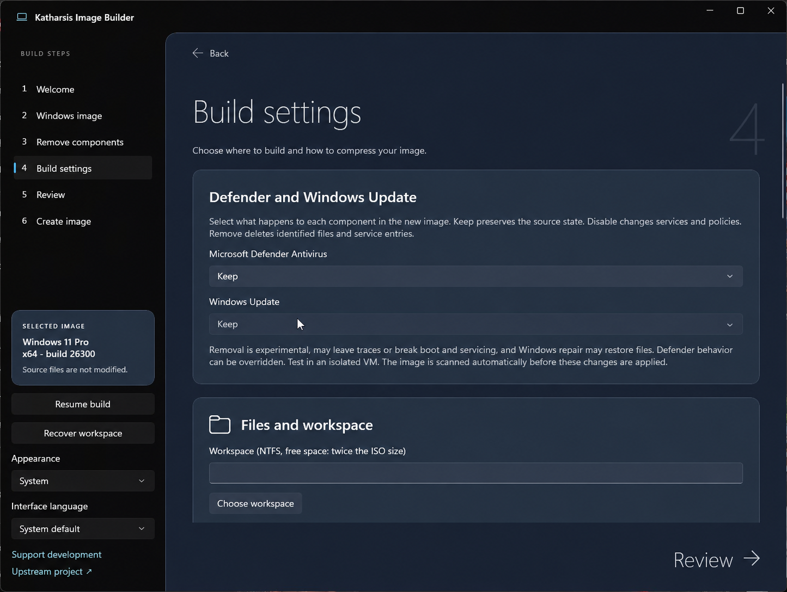
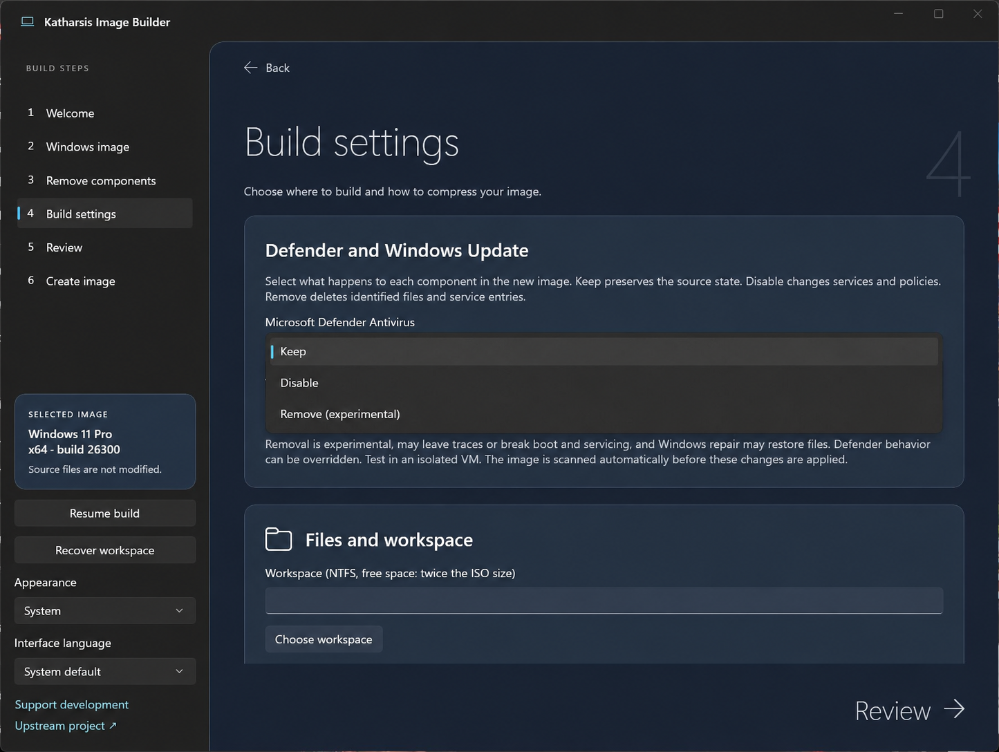

# Katharsis Image Builder

Katharsis builds customized Windows 11 installation media from an ISO or extracted installation folder. Its Windows desktop wizard lets you select apps, optional features and advanced image components, and choose independent actions for Microsoft Defender Antivirus and Windows Update.

## Screenshots

The Build settings page lets you keep Microsoft Defender Antivirus and Windows Update. Both are kept by default in Katharsis Balanced.



The Defender selector also offers Disable and experimental Remove. Windows Update has its own selector; Katharsis Plus requires Update removal.



## Build and run

Download the Windows x64 portable ZIP from [GitHub Releases](https://github.com/Indiangamer001/katharsis-image-builder/releases/latest), or build it from source using the instructions below. The archive includes the .NET and Windows App SDK runtimes; extract all files before running the app.

1. Open the extracted archive folder.
2. Open `Katharsis.exe` and approve the Windows administrator prompt.
3. Choose a Windows 11 ISO or installation-media folder, inspect it, select an edition and configure the build. Review the plan before building.

Windows 11 client images from 22H2 onward, x64 or ARM64, are supported by the image engine when compatible Microsoft image tools are available. This local portable package is for an **x64 host**. A Microsoft ISO and Windows activation are not included. The source media is read-only; the builder creates its own workspace and refuses to overwrite an existing output ISO.

## Build modes

- **Katharsis Balanced** applies the original-style app and feature removal set. Defender and Windows Update are kept by default and can be changed under **Build settings**.
- **Katharsis Plus** starts with the Balanced removal set and disables eleven service or driver entries where present. Windows Update removal is required; Defender defaults to Keep and can be changed independently. The services are listed in the review and confirmation. Printing, Bluetooth media controls, cameras, diagnostics, compatibility assistance and device management may be affected. Missing mandatory Update targets stop the build.
- **Katharsis Custom** lets you choose removal groups and inspect the selected image for individual apps, features, capabilities, services and other items.

Under **Build settings**, Defender Antivirus and Windows Update can each be kept, disabled, or targeted for experimental physical removal. Removal deletes identified service registrations and component/files; it is not a supported complete Windows uninstall and may leave traces or be reversed by repair. Windows may ignore Defender policies, and Update removal can affect Defender security-intelligence updates. Plus does not do the legacy blanket component-store pruning, so retaining Defender is not contradicted by the preset itself.

**Test the resulting ISO in a disposable VM.** No ISO size is guaranteed; aggressive changes can prevent installation, boot, servicing or application operation. This renamed local version has not completed an end-to-end ISO build and VM boot test. It should be treated as experimental, especially when removing security or servicing files.

## Build from source

Install the .NET 8 SDK and compatible Windows SDK / ADK Deployment Tools, then:

```powershell
dotnet test .\tests\Tiny11Builder.Core.Tests\Tiny11Builder.Core.Tests.csproj -c Release
.\scripts\package.ps1 -Architecture x64
```

Native registry and image tests require an elevated terminal; real-image tests are opt-in. The package script creates a self-contained archive and SHA-256 file under `artifacts\release`. ARM64 packaging is available from source but was not validated for this release.

## Attribution

Katharsis derives from [ntdevlabs/tiny11builder](https://github.com/ntdevlabs/tiny11builder). See [NOTICE.md](NOTICE.md) for attribution and distribution notices. The upstream repository has no standalone license; no additional license is asserted here. Windows installation media, activation keys and ADK executables are not bundled.
